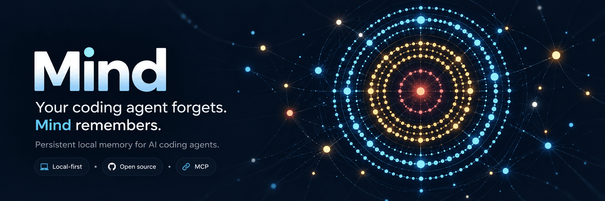

<div align="center">

# 🧠 Mind

**Your coding agent forgets. Mind remembers.**

Local, persistent memory for AI coding agents. Keep decisions, discoveries, fixes,
and working context available across sessions, context compaction, and tools.

**Local-first · Open source · MCP**

[](https://github.com/GabrielMartinMoran/mind/actions/workflows/main.yml)
[](https://github.com/GabrielMartinMoran/mind/releases)
[](LICENSE)
[](docs/agent-integration-matrix.md)

[Get started](#get-started) · [Documentation](docs/README.md) ·
[Supported agents](docs/agent-integration-matrix.md) · [Benchmarks](#benchmarks)

</div>

## Contents

- [Why Mind?](#why-mind)
- [Benchmarks](#benchmarks)
- [See Mind in action](#see-mind-in-action)
- [Get started](#get-started)
- [How Mind works](#how-mind-works)
- [Documentation](#documentation)
- [Contributing](#contributing)

## Why Mind?

Most coding agents lose useful context when sessions end, context is compacted,
or you switch tools. Mind gives them one local memory layer to carry knowledge forward.

- **Remember what matters.** Preserve decisions, constraints, bug fixes, patterns,
  and current references instead of rediscovering them every session.
- **Continue unfinished work.** Checkpoints and session summaries help agents
  pick up where they left off, including after compaction.
- **Connect knowledge.** Spaces, tags, directional links, and three memory tiers
  keep related information organized and useful as a project evolves.
- **Share context across tools.** The CLI, MCP server, HTTP API, and web app
  work with the same SQLite database.
- **Search without an API key.** Full-text retrieval works out of the box;
  OpenAI or OpenRouter embeddings are optional for semantic search.

## Benchmarks

### 🏆 86.67% answer accuracy. Top-3 territory. Even without embeddings.

Mind achieved **86.67% answer accuracy** on
[OmniMemEval LongMemEval-S](https://github.com/MemTensor/OmniMemEval),
putting it in **top-three territory by raw score** against
[published results](https://github.com/MemTensor/OmniMemEval/blob/main/docs/user_memory/results.md)
— with semantic RAG disabled.

**But remembering the right answer is only one part of memory.**

Mind is designed to build, connect, prioritize, and maintain knowledge over time:
promote useful memories, preserve superseded decisions, link related discoveries,
and recover the context needed for the next session.

_Benchmark note: Mind's completed run used a stratified subset and GPT-6 Luna
(low) for answering and judging, while the published comparisons use different
sample sizes and configurations. The top-three comparison is indicative, not an
official ranking. RAG was disabled; additional RAG-enabled tests produced similar
results but are not a controlled head-to-head comparison._

[Mind's benchmark methodology and results](benchmarks/omnimemeval/README.md) ·
[How the memory lifecycle works](docs/cognitive-memory-lifecycle.md)

## See Mind in action


Explore your memories in the web app, edit what matters, and follow
relationships in the per-space Neural Map.

## Get started

### 1. Install Mind

On macOS or Linux, run:

```bash
curl -fsSL https://raw.githubusercontent.com/GabrielMartinMoran/mind/main/scripts/install.sh | bash
```

The installer installs to user-local paths and installs [Bun](https://bun.sh/)
if needed. It doesn't require `sudo`. If your shell can't find `mind`, add
`~/.local/bin` to your `PATH` as instructed by the installer, then open a
new terminal.

[Install from source and advanced configuration](docs/configuration.md)

### 2. Connect your agents

```bash
mind setup
```

This configures **all supported agent integrations** and the shared
`mind-management` skill. It does not install the agent applications themselves
and may write configuration for agents that are not installed.

Only want one integration? Use `mind setup <agent>` (for example,
`mind setup codex`). Run `mind setup compatibility` to see supported,
partial, and unverified capabilities, or `mind setup refresh` to update
existing Mind-managed integrations.

[Supported agents and capability matrix](docs/agent-integration-matrix.md) ·
[Agent setup details](docs/agent-setup.md)

### 3. Try it

```bash
mind status
mind create projects/my-project "My project"
mind add projects/my-project architecture "CLI uses command registry + atomic command modules"
mind search architecture
mind serve start
```

Open [http://localhost:30303](http://localhost:30303) to inspect your memories.
Agents use Mind through its installed MCP integration; the commands above are
a quick way to explore the same store yourself.

**Using an agent to set up Mind?** Give it the installation steps above and ask
it to run `mind setup`, check `mind status`, and report
`mind setup compatibility` results. Your agent should distinguish configured
integrations from those actually validated on your machine.

## How Mind works

Mind is a persistent cognitive workspace, not just a collection of notes.

1. **Remember.** Save reusable decisions, fixes, discoveries, and references;
   use checkpoints for unfinished work and summaries for completed sessions.
2. **Recall.** Retrieve relevant context through Mind's unified full-text search,
   with optional embeddings when semantic search is enabled.
3. **Relate and evolve.** Link memories, maintain current references, preserve
   superseded knowledge, and let useful memories move between active and archive
   tiers as their use changes.
4. **Continue.** Agents follow the shared `mind-management` skill to recover
   context and manage memory across sessions and handoffs, subject to their
   integration's capabilities.

Everything lives in one local SQLite store (`mind.db`). Mind also supports
an **experimental** opt-in [Markdown autosync](docs/autosync.md) for versioned
project memories. Optional embedding providers make external API calls only
when semantic search is enabled.

[Memory lifecycle](docs/cognitive-memory-lifecycle.md) ·
[Project philosophy](docs/mind-philosophy.md)

## Documentation

Looking for something specific? Start with the
[documentation index](docs/README.md):

- [Agent compatibility and setup](docs/agent-integration-matrix.md)
- [CLI, web UI, and MCP reference](docs/interfaces.md)
- [Search engine and query syntax](docs/search-engine.md)
- [Autosync (experimental)](docs/autosync.md)
- [Configuration and optional semantic search](docs/configuration.md)
- [Skill-first agent protocol](docs/skill-first-distribution.md)

For all available CLI commands, run `mind help`.

## Contributing

Issues and pull requests are welcome. Read [CONTRIBUTING.md](CONTRIBUTING.md)
for contribution guidelines, tests, and quality gates, and
[Mind's philosophy](docs/mind-philosophy.md) for the project's principles.

## License

[MIT](LICENSE) · [Changelog](CHANGELOG.md)

<details>
<summary>Star history</summary>

<a href="https://www.star-history.com/?repos=gabrielmartinmoran%2Fmind&type=date&releases=&legend=bottom-right">
 <picture>
   <source media="(prefers-color-scheme: dark)" srcset="https://api.star-history.com/chart?repos=gabrielmartinmoran/mind&type=date&theme=dark&legend=bottom-right" />
   <source media="(prefers-color-scheme: light)" srcset="https://api.star-history.com/chart?repos=gabrielmartinmoran/mind&type=date&legend=bottom-right" />
   
 </picture>
</a>

</details>
