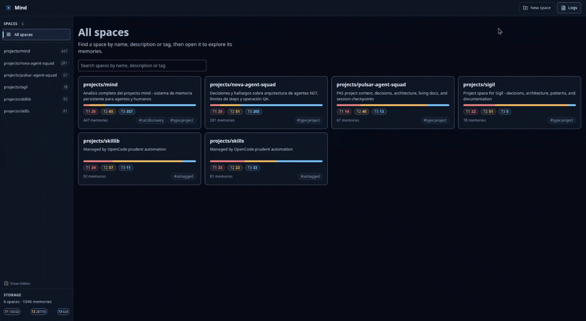

# 🧠 Mind

_**Stop losing context across sessions, tools, and time. Give your AI workflow a memory that lasts.**_

Mind is a local memory layer for AI workflows: a persistent memory system for
durable context such as decisions, bug fixes, patterns, checkpoints, and
session summaries that would otherwise disappear across sessions and tools.

It supports recovery after compaction through checkpoint and session
continuity behavior, while giving humans a way to visualize, inspect, and
modify that memory through the CLI and web UI.

**Why Mind works above the fold:**

- **Local persistent store.** One SQLite-backed memory system you control.
- **Built for agent workflows.** Use it through the CLI, MCP server, HTTP API,
  and web UI.
- **Resumption tools included.** Checkpoints and session summaries help recover
  context and continue work.
- **Optional file sync.** Experimental autosync can mirror project spaces into
  versioned `.mind/` files.
- **Search when you need it.** Full-text search is built in, and semantic
  search is available as an optional add-on.

Get started with [Installation](#installation) or jump straight to the
[Quick start](#quick-start).



## Why try Mind?

Mind helps you keep durable context organized, retrievable, and usable as work
moves across tools, sessions, and compaction boundaries.

- **Structured memory you can revisit.** Organize information into spaces,
  tags, directional links, tiers, pins, checkpoints, and session summaries.
- **A lifecycle, not a dump.** Capture durable knowledge, relate it, maintain
  current truth, supersede what changed, and hand off work across sessions.
- **Recovery built into the workflow.** Restore context after compaction,
  resume work from checkpoints, and keep important state visible over time.
- **Shared interfaces, one memory layer.** Use the CLI, MCP server, HTTP API,
  and web app against the same local source of truth.
- **Per-space visibility with Neural Map.** Each space includes a read-only
  graph view so you can understand how memories connect without claiming a
  global knowledge graph.

## What is Mind?

Mind is a Bun + TypeScript project that provides a CLI, an MCP server, an HTTP
API, and a web UI on top of one local SQLite memory store (`mind.db`). It uses
FTS5 full-text search, metadata filters, tags, links, and a 3-tier memory
model (T1 hot, T2 warm, T3 cold) to keep saved context useful over
time.

If you want semantic search, you can enable optional embeddings from OpenAI or
OpenRouter. They are off by default.

To learn how to decide what to remember, write durable memories, maintain tiers
and links, supersede old decisions, and keep living references current, see
[Cognitive memory lifecycle](docs/cognitive-memory-lifecycle.md). For the full
documentation map, start at the [documentation index](docs/README.md).

## Installation

You can install Mind quickly and start using it right away. If you want agent
setup later, jump to [Agent setup](#agent-setup).

### One-line installer (recommended)

```bash
curl -fsSL https://raw.githubusercontent.com/GabrielMartinMoran/mind/main/scripts/install.sh | bash
```

This installs Mind to user-local paths (no sudo):

- app: `~/.local/share/mind`
- launcher: `~/.local/bin/mind`

Then run:

```bash
mind help
```

The installer creates a launcher that runs the installed `src/mind.ts` entry
point. It doesn't configure every supported agent automatically. To refresh
existing mind-managed agent integrations after installation, run
`mind setup refresh`.

### Requirements

- [Bun](https://bun.sh/) 1.2+ (auto installed by the one-line installer if not present)

### Install from source

```bash
git clone https://github.com/GabrielMartinMoran/mind.git
cd mind
bun install
```

Mind is Bun-only. `bun.lock` is the only root lockfile, and the project does
not ship `package-lock.json`.

### Quick start

This is the fastest way to see what Mind feels like in practice.

```bash
# Create a project space
mind create projects/my-project "My project"

# Add a memory
mind add projects/my-project architecture "CLI uses command registry + atomic command modules"

# Search across memories
mind search architecture

# Start the web UI
mind serve start
# Open http://localhost:30303
```

### Agent setup

Mind supports multiple agent integrations, but they are not all equally mature.
Run `mind setup` without an agent name to see the current capability matrix,
then configure the specific agent you want.

```bash
mind setup              # show capability matrix first
mind setup claude-code
mind setup opencode
mind setup cursor
mind setup codex
mind setup windsurf
mind setup gemini-cli
mind setup vscode
mind setup antigravity
mind setup pi
mind setup refresh      # refresh detected mind-managed integrations
```

`mind setup refresh` is conservative by default. It refreshes only detected
integrations, where detection means mind finds an existing mind-owned signal,
such as an MCP config, managed activation pointer block, hook/plugin/script, or
installed mind-management skill. Use `--dry-run` to preview changes, `--all` to
refresh all supported agents, or `--agent <name>` to target one agent.

### Skill-first protocol

Mind keeps one canonical protocol and one complete `mind-management` skill. The
skill installs once at `~/.agents/skills/mind-management`; Claude Code and
Antigravity receive a symlink or managed copy because they do not read the
global directory. The skill is the single source of truth for Mind. Load it
unconditionally at session start and after compaction, before any Mind use; do
not call a Mind MCP tool until it is loaded. Client L2 instructions and the MCP
`initialize.instructions` handshake are activation pointers, not the protocol.
If the skill is not listed or cannot be loaded, call the `system_instructions`
MCP tool for the complete protocol at version `2.1.0`. That fallback is
complete but secondary; the skill is the primary source of truth.

Mind does not track reads in a database, enforce a quota, or create a checkpoint
just to record activation. Setup updates only the exact `mind-management` skill
in its managed locations; it leaves other skills untouched and replaces
`SKILL.md` atomically without leaving a skill backup. Ancestor-repair and agent
config backups remain outside skill paths. Older skill backups are not deleted
automatically; remove them manually if desired. See the
[documentation index](docs/README.md),
[`docs/skill-first-distribution.md`](docs/skill-first-distribution.md), and the
[agent integration matrix](docs/agent-integration-matrix.md).

### Post-install configuration

Most configuration is optional. You only need extra setup if you want to change
paths, ports, or enable semantic search.

**1. Create your .env file:**

```bash
cp .env.example .env
```

Mind ships with a `.env.example` that contains all configurable options. The installer will also do this automatically if `.env` doesn't exist.

**2. Configure environment variables (optional):**

Edit `.env` to customize your setup:

| Variable                     | Default   | Description                                                  |
| ---------------------------- | --------- | ------------------------------------------------------------ |
| `MIND_PORT`                  | `30303`   | Port for the web server                                      |
| `MIND_DATA_DIR`              | `data/`   | Directory for SQLite database and data                       |
| `MIND_LOG_RETENTION_MINUTES` | `10080`   | Log retention in minutes (default 7 days)                    |
| `MIND_RAG`                   | _(empty)_ | Set to `true` to enable semantic search                      |
| `MIND_EMBEDDING_PROVIDER`    | `openai`  | Embedding provider for RAG: `openai` or `openrouter`         |
| `OPENAI_API_KEY`             | _(empty)_ | Your OpenAI API key (required for RAG with `openai`)         |
| `OPENROUTER_API_KEY`         | _(empty)_ | Your OpenRouter API key (required for RAG with `openrouter`) |

**RAG / semantic search setup:**

To enable AI-powered semantic search, set `MIND_RAG=true` and provide the API
key for your embedding provider. Mind uses OpenAI by default.

OpenAI (default):

```bash
# In .env:
MIND_RAG=true
OPENAI_API_KEY=sk-your-key-here
```

OpenRouter:

```bash
# In .env:
MIND_RAG=true
MIND_EMBEDDING_PROVIDER=openrouter
OPENROUTER_API_KEY=sk-or-your-key-here
```

Mind embeds memories with `text-embedding-3-small` (OpenAI) or
`openai/text-embedding-3-small` (OpenRouter) and combines the embeddings with
full-text search for hybrid retrieval. Both providers return 1536-dimension
vectors, so switching providers keeps existing stored embeddings valid; Mind
doesn't re-embed memories.

Provider values are matched case-insensitively. Mind uses only the selected
provider's key. If `MIND_EMBEDDING_PROVIDER` holds an unsupported value, RAG
stays disabled and Mind doesn't fall back to another provider. Run
`mind status` to see the active provider or the reason RAG is disabled.

## Basic CLI example

```bash
mind create projects/mind "Mind project memory"
mind add projects/mind architecture "CLI uses command registry + atomic command modules"
mind search architecture
```

For the full command list:

```bash
mind help
```

## Search

Mind ships one unified relevance search across the CLI, MCP server, and HTTP
API. The pipeline parses your query, collects candidates through several
logically independent retrieval channels, and fuses them into a single ranked
list. Each result carries a confidence bucket so you can judge how strong the
match is. For the current pipeline, storage, and known limits, see the
[search engine](docs/search-engine.md) page.

Query grammar:

- `"quoted text"` matches an exact phrase.
- `OR` unions alternatives; adjacent terms are ANDed. `AND` is the explicit
  form of the implicit AND.
- `NOT` excludes the following term (`auth NOT jwt`).
- A trailing `*` matches a prefix (`type*`).
- Malformed operator usage never errors; it degrades to a safe literal match.

Multi-word queries relax automatically. Exact phrase and all-term matches rank
first, followed by near matches, substrings, and close spellings:

- **Phrase** and **all-term** channels handle literal token matches.
- **Trigram** and **fuzzy** channels handle substrings and typos
  (Damerau–Levenshtein distance up to 2). The trigram index folds diacritics, so
  accented and unaccented queries match both ways. The fuzzy channel requires a
  shared 3-character prefix, so a typo in the first three characters of a word
  isn't recovered.
- **Token-set** coverage ranks partial multi-word matches.
- A **semantic** channel blends in embeddings when you enable RAG. Natural-language
  queries can admit semantic-only matches at cosine ≥0.6 even when lexical
  results exist; explicit phrases, prefixes, and operators stay lexical.

Every result includes a `confidence` bucket (`high`, `medium`, `low`) and a
`methods` list naming the channels that matched it. The CLI prints the bucket as
`[high]`, `[medium]`, or `[low]`. If RAG is off, search still works and just
omits the semantic channel. If an embedding request fails, Mind skips semantic
search for about five minutes instead of retrying on every query.

In the web UI, search stays scoped to the open space. Clearing the query removes
old results and restores the loaded memory list when its filters still match.

Limits:

- CLI `search` returns 25 results by default. Use `--limit` (maximum 500) and
  `--offset` to page through results.
- MCP `memory_query` and `GET /api/search` accept the same `limit` (default 25,
  maximum 500) and `offset`.

## Usage

### CLI

```bash
mind help
mind create <space> "description"
mind update <space> --hidden
mind list --hidden
mind add <space> <name> "content"
mind list <space>
mind read <space> <name>
mind checkpoint set <space> "goal" "pending"
mind checkpoint recover <space> --name <checkpoint-name>
mind checkpoint complete <space> <name> "what was done"
mind migrate sessions projects/<repo> --dry-run
mind checkpoint list <space> --status active
mind search "query"
mind query --space <space> --from 2026-01-01 --to 2026-12-31 --limit 20 --offset 0
mind update --check
mind update
```

### Autosync (Experimental)

Autosync lets you mirror project spaces to a versioned `.mind/` directory so
you can review memory files in git, edit markdown on disk, and sync those
changes back into the local database. When a space is enabled, successful DB
mutations made through the CLI, web/API, or MCP also export the affected space
back to `.mind/spaces/<hash>/` as a non-blocking side effect.

<!-- prettier-ignore -->
> [!NOTE]
> This is an experimental feature currently under active development.

Set up autosync with the following flow:

1. Run `mind sync init` to create `.mind/config.yml` and `.mind/.gitignore`.
2. Review or edit `.mind/config.yml` to choose which spaces are configured.
3. Run `mind sync enable --space <name>` for the project space you want to
   sync.
4. Optional: Run `mind sync serve --space <name>` to start the watcher in the
   current terminal, or rely on MCP startup to auto-start watchers for enabled
   spaces.

The `.mind/` directory uses a file-based config and hashed space directories:

```text
.mind/
├── config.yml
├── .gitignore
└── spaces/
    └── a1b2c3d4/
        ├── manifest.json
        └── memory-name.md
```

Use these commands to manage autosync:

- `mind sync init`
- `mind sync status`
- `mind sync enable --space <name>`
- `mind sync disable --space <name>`
- `mind sync now --space <name>`
- `mind sync export --space <name>`
- `mind sync import --space <name>`
- `mind sync conflict --space <name> --strategy <strategy>`
- `mind sync remove --space <name>`
- `mind sync config`
- `mind sync serve --space <name>`

Conflict strategies:

- `db-wins` writes the DB version on real conflicts and prunes only files that
  the manifest marks as managed.
- `file-wins` preserves the file side on real conflicts. Automatic DB-to-file
  exports skip the conflicting file and record a warning.
- `latest-wins` uses normalized UTC timestamps as a tie-break after hash-based
  dirty detection. Near-future timestamps within five minutes are accepted for
  clock skew, while farther future timestamps are reported as unsafe and skipped
  instead of blindly overwriting.

Autosync writes manifest v2 files. Each manifest entry tracks managed file
ownership, the memory name, path, optional DB ID, canonical content and metadata
hashes, normalized UTC timestamps, file modification time, and the last sync
time. Hashes decide whether the DB side, file side, both sides, or neither side
changed since the common baseline. A file's mere existence isn't a conflict.

Example `.mind/config.yml`:

```yaml
# mind autosync config

version: 1

# Spaces to sync with this project
# To enable a new space, add it below with enabled: true
# Valid conflictResolution values: db-wins, file-wins, latest-wins
spaces:
  # projects/mind:
  #   enabled: true
  #   conflictResolution: db-wins
```

Current limitations and caveats:

- `mind sync status --space <name>` reports DB, file, and manifest counts,
  dirty DB/file drift, conflicts, tombstones, missing managed files, and the
  latest auto-export warning or error when manifest data is available.
- Existing-memory imports update supported metadata from files when the conflict
  strategy chooses file-to-DB: content, tags, tier, pinned state, and `links_to`
  links. Invalid metadata skips that file safely, unresolved links are reported,
  and frontmatter `name` does not rename existing memories.
- Exported `links_to` values are written to frontmatter, and imports recreate
  those links in the database.
- Deleting a synced markdown file does not auto-delete the corresponding
  database memory. `mind sync status` reports missing managed files as drift so
  you can restore or delete intentionally. DB-side deletes and renames prune only
  files that the manifest marks as managed.
- Automatic DB-to-file export warnings are recorded in logs and don't fail the
  original CLI, API, or MCP mutation. Explicit `sync export`, `sync import`, and
  `sync now` commands still report sync failures visibly.

### Web Server

```bash
mind serve start
mind serve start --port 8080
mind serve start --detached
mind serve stop
```

### Neural Map (Web MVP)

In the web UI, each space now has a **Neural Map** view:

- read-only graph per space
- concentric rings by tier (**T1..T3**)
- pan + zoom controls
- node prominence based on connectivity (link degree)
- click a node to fetch/show memory details via existing memory detail endpoint

The SPA uses URL-driven client routing for reliable deep-linking and reload recovery:

- `/` → spaces home
- `/spaces/{encodedSpace}`
- `?view=list|map`
- optional `?memory={encodedMemory}`

Navigation updates the URL (space open, list/map switch, memory selection), reload restores state, and browser back/forward is supported via History API.

Graph API endpoint used by the SPA:

- `GET /api/spaces/:space/graph?limit=<n>`
- returns minimal payload per node: `id:string`, `name`, `tier`, `links_to:string[]`, `linked_by:string[]`
- includes all tiers by default
- includes truncation metadata (`total_nodes`, `returned_nodes`, `requested_limit`, `applied_limit`, `max_limit`, `truncated`)

### MCP Server

```bash
mind mcp                           # stdio mode
mind mcp start --http              # HTTP mode
mind mcp start --http --detached   # HTTP background
mind mcp stop
```

When the MCP server starts, it auto-starts autosync watchers for spaces that
are enabled in `.mind/config.yml`.

Example MCP tool usage (for agents):

```json
{
  "name": "memory_query",
  "arguments": {
    "space": "Credentials",
    "search": "query terms",
    "from": "2026-03-01",
    "to": "2026-03-31",
    "limit": 25,
    "offset": 0
  }
}
```

Stage 1 MCP structured tools now return the same payload in two forms:

- `structuredContent` for agents that consume structured data directly
- one raw YAML `content` text item serialized from that same payload (no markdown fences)

In this stage, `system_instructions` and the content-only delete/link tools keep their existing text responses.

`memory_query` supports optional `search` for full-text search and returns pagination fields such as `limit` and `offset` in both `structuredContent` and YAML content. Search results also include `confidence` and `methods`, and the payload reports a `search_method` compatibility mapping. Its optional `tier` field also accepts `null`, which means the same thing as omitting the tier filter (all tiers).

Memory MCP workflows also support bounded composite ergonomics while keeping atomic tools:

- `memory_add` supports optional `pinned` and `links_to` (best-effort — check `links_failed` in response).
- `memory_read` returns directional linked summaries via `links_to` and `linked_by` with each relation's `label` and `direction` (`outgoing`/`incoming`). Use `noPromote:true` to inspect without promotion.
- `memory_update` updates `newName`/`content`/`tags`, sets `pinned`, and moves one tier with `tierTransition` (`promote`/`demote`). `tags` replaces the existing set.
- `link_create` is directional (`sourceRef` → `targetRef`) with a label; re-creating the same directed pair replaces the label. `link_delete` is a no-op when the link is absent.
- Memory MCP payloads use `changed_at` and do not expose `access_count`,
  `last_accessed_at`, `created_at`, or `updated_at`.

`space_get` now returns an orientation summary for one space:

- `overview` with total memory count, active checkpoint count, and per-tier
  counts
- `trending_memories` grouped into `tier_1`, `tier_2`, and `tier_3`, ranked by
  `changed_at`, with a bounded T3 preview plus total availability
- per-tier `coverage` metadata so agents can tell whether each preview is
  complete or only a subset
- a `references` block of living references (`type:reference` + `status:living`)
- plural `active_checkpoints` with checkpoint items matching `checkpoint_query`

Checkpoint MCP tools are also available for session continuity:

- `checkpoint_save`
- `checkpoint_done`
- `checkpoint_load`
- `checkpoint_query`

`checkpoint_done` now closes a live checkpoint into a same-space `session-*` summary memory in `projects/<repo>` with tags `type:session` + `cat:summary` at T3. Legacy `sessions/<repo>` content can be explicitly migrated with `mind migrate sessions <project-space> [--dry-run]`.

`checkpoint_load` requires `checkpointName` (use `checkpoint_query` first to find available checkpoints). It returns full checkpoint text fields plus all linked_memories in enriched format, and checkpoint MCP payloads use `changed_at` instead of `created_at` / `updated_at`.

`checkpoint_query` returns full pending text (no preview truncation) and includes an explicit `error` field (`null` on success, `{ code, message }` when the requested space is missing).

System tools for agent protocol:

- `system_instructions` — returns the complete Mind protocol (six responsibilities and tool examples) as an optional reference
- `status` — get storage status

### Agent integration details

Use the commands in [Installation](#installation) to run setup. This section
explains how to read the capability matrix and what each integration actually
configures.

`mind setup` (without agent) now prints a capability matrix per integration using a 3-level model:

- **L1**: MCP transport wiring
- **L2**: instruction/protocol injection
- **L3**: hooks/session/compaction automation

Each level is explicitly marked as `supported`, `unsupported`, or `unverified` with evidence/fallback notes.
If a capability is not implemented, setup output is explicit (no silent skip).

#### Agent status matrix

Status labels used here:

- **Complete**: L1/L2/L3 are all `supported`
- **Partial**: at least one level is `unsupported` or `unverified`
- **Experimental**: declaration exists but integration is explicitly unstable/unverified
- **Roadmap**: planned declaration only, no adapter wiring

| **Agent**         | **Status** | **Capability reality**                                        |
| :---------------- | :--------- | :------------------------------------------------------------ |
| OpenCode          | Complete   | L1 `supported`, L2 `supported`, L3 `supported`                |
| Claude Code       | Complete   | L1 `supported`, L2 `supported`, L3 `supported` (opt-in hooks) |
| Codex             | Partial    | L1 `supported`, L2 `supported`, L3 `unsupported`              |
| Cursor            | Partial    | L1 `supported`, L2 `unverified`, L3 `unverified`              |
| Windsurf / Devin  | Partial    | L1 `supported`, L2 `unsupported`, L3 `unsupported`            |
| Gemini CLI        | Partial    | L1 `supported`, L2 `unsupported`, L3 `unsupported`            |
| VS Code / Copilot | Partial    | L1 `supported`, L2 `unsupported`, L3 `unsupported`            |
| Antigravity       | Partial    | L1 `supported`, L2 `unsupported`, L3 `unsupported`            |
| Pi Agent          | Partial    | L1 `supported`, L2 `supported`, L3 `unverified`               |

Skill installation is reported separately from the L1/L2/L3 badges. Mind
installs one canonical skill at `~/.agents/skills/mind-management`; Claude Code
and Antigravity receive a symlink (or managed copy fallback), and managed
shadow copies in client-specific skill directories are migrated. See
[`docs/agent-integration-matrix.md`](docs/agent-integration-matrix.md) for the
documented paths, instruction support, hooks, and unverified surfaces.

Rollout policy:

- Wave 1 priority agents: **OpenCode, Claude Code, Gemini CLI, Cursor**
- Claude Code now includes managed **L2 protocol injection** by writing `~/.claude/instructions/mind-memory-protocol.md` and maintaining a managed block in `~/.claude/CLAUDE.md`
- Claude Code **L3 hooks automation is opt-in and non-blocking** (default off). Enable with `MIND_SETUP_CLAUDE_ENABLE_HOOKS=true` before running setup.
- Cursor **L2** remains intentionally **unverified** (no verified global user-rules injection path)
- Cursor **L3** writes the documented `{ "version": 1, "hooks": { ... } }` schema with `sessionStart`, `preCompact`, `sessionEnd`, and `stop`, but hook execution is marked **unverified** because it was not live-tested
- Existing integrations outside Wave 1 remain wired in the same capability model with explicit status
- Windsurf/Devin writes `~/.config/devin/mcp_config.json` (the legacy `~/.windsurf/mcp.json` path is detection-only); VS Code/Copilot writes portable `~/.copilot/mcp-config.json`; Antigravity writes `~/.gemini/config/mcp_config.json` and uses `~/.gemini/config/skills`
- Pi Agent is a **supported** L1/L2 integration with MCP at `~/.pi/agent/mcp.json`, a managed activation pointer in `~/.pi/agent/AGENTS.md`, and the shared `~/.agents` skill; Mind does not install a Pi plugin and marks L3 **unverified**
- Codex, Gemini CLI, VS Code/Copilot, and Antigravity document hooks, but Mind does not implement L3 automation for them

`mind setup opencode` is idempotent and non-destructive:

- prefers `~/.config/opencode/opencode.jsonc` over `opencode.json` when both exist, and never creates `opencode.json` if `opencode.jsonc` is already present. New files are created as `opencode.jsonc` (the JSONC superset of JSON that OpenCode accepts natively).
- preserves unknown keys already present in the chosen config file
- configures `mcp.mind` as local command transport (`type: "local"`, `command: ["<path-to-mind>", "mcp"]`)
- writes/refreshes `~/.config/opencode/instructions/mind-memory-protocol.md`
- ensures that instruction file is present in OpenCode's `instructions` list
- configures prudent L3 session/compaction automation by default and non-blocking, writing `~/.config/opencode/plugins/mind-automation.js` during setup. The generated plugin default-exports an OpenCode V2 plugin definition (`id` + `setup`) and also exposes V1 `server()` hooks, so the same file loads on OpenCode V2 and on V1 builds that support object plugin entrypoints (1.18.29+); older V1 builds keep loading it through the named `MindAutomationPlugin` export

> **Setup safety contract:** all setup flows that touch a user-owned JSON/JSONC config file (opencode, claude fallback, cursor, windsurf/devin, gemini-cli, vscode/copilot, antigravity, pi) now go through `src/setup/safe-config.ts`. Existing files are parsed strictly — a parse failure aborts the run with a clear error rather than overwriting the file with an empty default. Content-changing writes are preceded by a timestamped sibling backup (`.bak.YYYYMMDDTHHMMSSmmmZ`) and the new content is staged in a sibling `.tmp` file and renamed into place so a crash mid-write cannot leave a partial file. The same contract applies to `mind setup refresh`.

`mind setup codex` keeps setup idempotent and writes local MCP command args in `~/.codex/config.toml`:

- `[mcp_servers.mind]`
- `command = "<path-to-mind>"`
- `args = ["mcp"]`

It also non-destructively upserts a managed Mind activation pointer block in `~/.codex/AGENTS.md`. Project `AGENTS.md` files must point to the skill and fallback, not restate the protocol.

`mind setup cursor` keeps existing MCP setup behavior and configures global L3 hooks using the documented envelope:

- writes/updates `~/.cursor/hooks.json` using the documented `{ "version": 1, "hooks": { ... } }` schema with managed idempotent entries for `sessionStart`, `preCompact`, `sessionEnd`, and `stop`
- writes/refreshes a non-mutating shim script at `~/.cursor/hooks/mind-session-continuity.sh` for those events; it does not create, overwrite, or complete checkpoints
- preserves unrelated hook config keys and entries, and migrates an older top-level event map into the documented envelope
- hook execution and payload shape are marked **unverified** because they were not live-tested

`mind setup pi` configures the Pi Agent with the minimal integration:

- writes `~/.pi/agent/mcp.json` with `mcpServers.mind` over stdio
- upserts a managed activation pointer block in `~/.pi/agent/AGENTS.md` without touching unrelated content
- installs the shared `~/.agents/skills/mind-management` skill and migrates a managed Pi-specific shadow copy
- does not install a Pi plugin; Pi documents extensions, but Mind marks hook automation **unverified**

Check server process status:

```bash
mind server-status
```

### Update

mind can update itself from GitHub Releases:

```bash
mind update --check                 # check if a newer release exists
mind update                         # update to latest release
mind update --version v0.1.0        # update to a specific tag
mind update --no-refresh-integrations
```

After a successful update, if a database existed before installation, Mind runs
the newly installed `mind status` first. This forces automatic DB migration,
backup validation, and restore handling before refreshing integrations. Fresh
installs with no existing DB skip this step so `mind update` doesn't create a
database. Mind then refreshes detected mind-managed integrations by default so
protocols, MCP configs, hooks, plugins, scripts, skills, and managed cleanup stay
current. Use `--no-refresh-integrations` to skip the integration refresh.

## Data Storage

Mind stores its primary database in SQLite and can also keep optional
autosync files in a versioned `.mind/` directory.

- Default DB path: `data/mind.db`
- Optional autosync config and exported files: `.mind/`
- Override directory: `MIND_DATA_DIR=/custom/path`
- Override full DB path: `MIND_DB_PATH=/custom/path/mind.db`

Legacy migration:

```bash
mind import
```

## Project Structure

```text
src/
  cli/        # CLI parser, command registry, setup/runtime helpers
  mcp/        # MCP command + MCP server + tools
  api/        # HTTP command, router, route modules, API server
  helpers/    # logger, tags, format, rag helpers
  sync/       # autosync config, import/export, conflicts, file watcher
  store/      # SQLite schema + MindStore implementation
  mind.ts     # main entrypoint used by mind

test/        # backend/CLI tests

web/src/      # frontend runtime modules (ESM, no build step)
web/styles/   # split CSS (tokens/base/layout/components/utilities)
web/assets/   # static assets (logo, images)
web/public/   # SPA HTML shell (index.html)
web/test/     # web-only tests
```

## Testing

Run unit tests:

```bash
bun test test/ web/test
```

Run web-only tests:

```bash
bun test web/test
```

Run RAG integration test (requires `OPENAI_API_KEY`):

```bash
make test-rag
```

Run the search relevance evaluation suite (deterministic fixture corpus, no API
key required):

```bash
make search-eval
```

Run the agent memory benchmark's free suites. The benchmark is an independent
Bun subproject with its own lockfile and dependencies, so install it separately:

```bash
cd benchmarks/agent-memory
bun install --frozen-lockfile
bun run typecheck
bun test test
bun test experiments
```

The root `make bench-agent-memory-test` target delegates to both suites. Paid
benchmark stages require an explicit `--budget` cap and do not run in CI. The
root project does not install `@opencode/sdk`; the benchmark declares it.

CI runs the root and benchmark free suites from their frozen `bun.lock` files
and pins Bun 1.3.14. Both jobs run `bun audit --audit-level=high` as a blocking
gate with no suppression. The root audit currently reports zero advisories; the
benchmark audit passes at high severity with documented moderate and low
residuals. See the [documentation index](docs/README.md) for current status and
the [exceptional historical evidence](docs/README.md#exceptional-historical-evidence)
it lists.

## Maintainers: Releases

Release management is handled via `Makefile` and `scripts/release.sh`:

```bash
make help
make release-patch
make release-minor
make release-major
make release-simulate TYPE=patch
./scripts/release.sh minor --notes-file docs/release-notes/v1.5.0.md
```

`release-simulate` runs a full release simulation without changing files, creating
tags, or publishing a release. Real releases must run from `main`. Use
`--notes-file <path>` when you want curated GitHub release notes; omit it to use
GitHub's generated release notes fallback.

## Contributing

Issues and PRs are welcome.

- Keep changes focused and documented.
- Preserve command behavior and compatibility when possible.
- Update `AGENTS.md` when architecture or command behavior changes.

## License

[MIT](./LICENSE)

For release history, see [CHANGELOG.md](./CHANGELOG.md).
